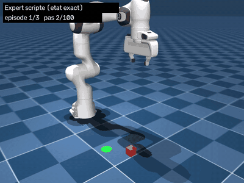
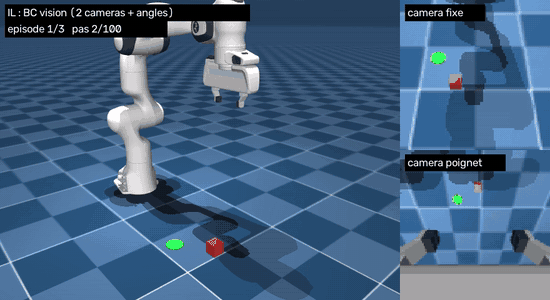
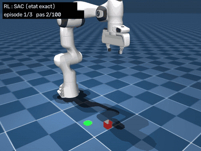
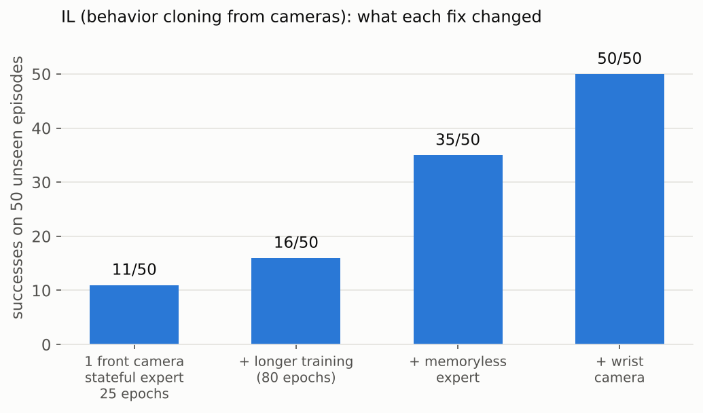
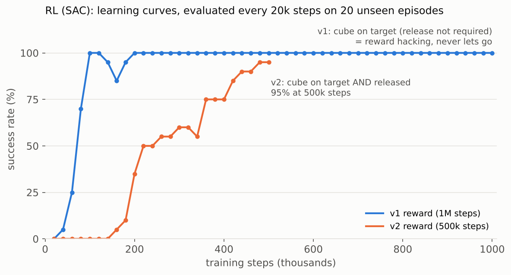

# Panda pick-and-place: imitation learning vs reinforcement learning


A Franka Panda learns to pick up a cube and place it on a target, both placed at random, in MuJoCo.
The same task is solved twice: once by **imitating a scripted expert from camera images**, once by
**reinforcement learning from a reward only**, so the two approaches can be compared.

This is the simulation stage of my final-year engineering project (PFE, Polytech Montpellier),
*Digital twin and AI for autonomous robotic manipulation with a Franka Panda*.
It runs on a laptop CPU, before moving to Isaac Sim and the real robot.

| Scripted expert | Imitation learning (2 cameras) | Reinforcement learning (SAC) |
|:---:|:---:|:---:|
|  |  |  |
| reads the exact simulator state | sees only a fixed camera, a wrist camera and its joint angles (right panels) | learns from a reward, no demonstrations |

## Results

Evaluated on 50 cube and target positions never seen during training.

| | Imitation learning (behavior cloning) | Reinforcement learning (SAC) |
|---|---|---|
| Input | 2 RGB cameras (96 × 96) + 7 joint angles + gripper width | exact state (tool, cube and target positions) |
| What it needs | a scripted expert and 150 demonstrations | a well-designed reward |
| Success | **50/50** | **49/50** |
| Compute (laptop CPU) | ~20 min of demos + ~50 min of training | ~4 h for 500k steps |
| Hardest part | choosing the cameras, designing an imitable expert | writing the reward |

The comparison is not yet apples to apples: the IL policy works from images, the RL policy from the exact state.

## The task

- **Robot**: Franka Panda from [MuJoCo Menagerie](https://github.com/google-deepmind/mujoco_menagerie), controlled with
  4 actions: a Cartesian displacement of the tool (up to 2 cm per step) and open/close the gripper.
  A differential IK (damped least squares, null-space pull for the 7th joint) turns the displacement into joint targets.
- **Episode**: 100 steps of 40 ms (4 s). Cube (4 cm) and green target mark drawn at random on the table.
- **Success**: at the end of the episode, the cube rests within 3 cm of the target **and has been released**.

## Imitation learning

1. A **scripted expert** (state machine + proportional controller) reads the exact simulator state and solves the task 49/50.
2. It records 150 demonstrations: camera images, joint angles, and its own actions.
3. A **CNN per camera + an MLP** learns to reproduce the expert's action from what the robot can actually sense.



Getting from 11/50 to 50/50 was a debugging exercise. A diagnostic script (`il/diagnose_bc_vision.py`) splits
each failure into perception, imitation and closed-loop drift, using the simulator's ground truth:

- **The expert must be imitable.** My first expert remembered its phase and used a timer to close the gripper,
  which is invisible in a single image. A memoryless expert, which decides only from the current scene, took the policy from 16/50 to 35/50.
- **Cameras matter more than the network.** With a single front camera, the gripper hid the target at the moment of placing the cube.
  Adding a wrist camera took the policy from 35/50 to 50/50: the fixed camera tells *where to go*, the wrist camera gives the final precision.
- DAgger (the expert relabels the states the policy visits) was implemented but not needed in the end.

## Reinforcement learning

SAC (Stable-Baselines3) on the exact state, with a staged reward: reach the cube, hold it, bring it to the target, release it.



Most of the work went into the reward, and each failure is a classic RL lesson:

- **Reward hacking (v1).** Success only asked for the cube to be on the target. The robot reached 100% by placing the cube
  and *never letting go*. Fix: success requires the gripper to be open.
- **Local optimum.** When releasing became more valuable, holding the cube far from the target still paid enough:
  the robot grasped it and stopped there. Fix: each stage must pay clearly more than the previous one.
- **Reward valley.** While opening, the gripper spent two steps neither "holding" nor "released", where the reward collapsed
  just before the success bonus. The robot never crossed it. Fix: "released" starts exactly where "holding" ends.

The final policy succeeds 49/50 and is faster than the expert. It does not retract the arm after releasing,
because nothing rewards it yet. The RL agent only does what the reward asks.

## Repository layout

```
common/   panda_pick_env.py   Gymnasium env: robot, cube, target, 2 cameras, IK, reward
          test_expert.py      scripted, memoryless expert + its test
il/       record_demos*.py, train_bc*.py, diagnose_bc_vision.py, dagger.py
rl/       train_rl.py, eval_rl.py
videos/   make_videos.py      renders the videos above
media/    GIFs, MP4s and figures used in this README
```

## Quick start

```bash
python -m venv venv && venv\Scripts\activate          # Windows (source venv/bin/activate on Linux)
python -m pip install -r requirements.txt
git clone --depth 1 https://github.com/google-deepmind/mujoco_menagerie.git   # robot model, at the repo root

python common/test_expert.py --view       # watch the expert
python il/record_demos_vision.py          # 150 demos with both cameras
python il/train_bc_vision.py              # train + evaluate on 50 unseen episodes
python il/train_bc_vision.py --eval --view
python rl/train_rl.py 500000              # SAC, a few hours on CPU
python rl/eval_rl.py --view
python videos/make_videos.py              # expert / IL / RL videos
```

Every script writes its outputs (demos, models, logs) next to itself.

## Next steps

- Realistic perception: simulated RealSense-like cameras with depth, and object detection, so that the cube and target
  positions come from the cameras rather than from the simulator.
- Human demonstrations through teleoperation (haptic interface) instead of a scripted expert.
- Hybrid control: trajectory generation for the transport, RL for grasping and placing.
- Obstacle avoidance, then the same task in Isaac Sim, then on the real Franka Panda.
